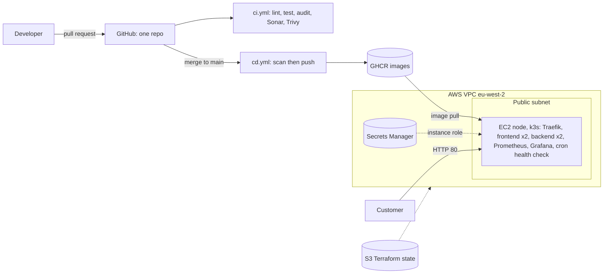

# Zuri Market DevOps Capstone

A small e-commerce store (React frontend, Node/Express backend) delivered through a reviewed, tested, scanned and monitored pipeline: **GitHub Actions → GHCR → Kubernetes (k3s) on AWS**, provisioned with **Terraform** and observed with **Prometheus and Grafana**. Secrets live in **AWS Secrets Manager**, never in Git.

## 1. Overview: the four problems Zuri had

| Failure at Zuri | Control in this repository |
|---|---|
| Everyone pushed to `main`; a bad release caused a six-hour outage | Branch ruleset: pull request required, review, no force push, empty bypass list |
| No automated quality or security checks | ESLint, tests, `npm audit`, SonarQube quality gate, Trivy image scan, SHA-pinned actions |
| Manual, unrepeatable infrastructure | Terraform modules, two environments, remote state in S3, IAM least privilege, SSM instead of SSH |
| No monitoring; outages found by customers | Health endpoint and probes, Prometheus + Grafana dashboard, daily cron health report |

## 2. Architecture



Key decisions: k3s on one EC2 node instead of EKS (the EKS control plane alone costs about US$0.10/hour); no SSH and no key pair (SSM Session Manager); security group allows port 80 only; no NAT gateway; `/metrics` is outside `/api`, so the Ingress never exposes it.

## 3. Repository structure

```
zuri-market-capstone/
  backend/            Node/Express API + Dockerfile, tests, ESLint config   (see backend/README.md)
  frontend/           React/Vite app + Dockerfile, nginx.conf                (see frontend/README.md)
  terraform/
    bootstrap/        S3 state bucket (local state, run once)
    modules/          network, secrets, security, compute
    environments/     dev, prod
  k8s/                namespace, ingress, rbac, backend/, frontend/
  monitoring/         Grafana dashboard JSON
  scripts/            sync-secrets.sh, set-image.sh, health-check.sh
  docs/               architecture, Jenkins vs GitHub Actions
  .github/workflows/  ci.yml (pull requests), cd.yml (merge to main)
  docker-compose.yml
```

**Credits.** Starter code from
[Test-class2026/zuriapp-backend](https://github.com/Test-class2026/zuriapp-backend) and
[Test-class2026/zuriapp-frontend](https://github.com/Test-class2026/zuriapp-frontend).

## 4. Run locally

Prerequisites: Node 22 (`nvm use`), Docker with Compose.

**With Docker Compose (whole stack):**

```bash
cp .env.example .env          # fake local values only; .env is git-ignored
docker compose up --build -d
docker compose ps             # backend healthy, frontend running
```

Open http://localhost:8080. The backend is also on http://localhost:5000. Stop with `docker compose down`.

**Without Docker:** run each app from its folder (see the backend and frontend READMEs). Frontend dev server: http://localhost:3000.

## 5. Run in the cloud (Terraform and deploy)

Prerequisites: Terraform 1.11 or newer, AWS CLI v2, Session Manager plugin, a non-root AWS identity.

```bash
# 1. State bucket (once)
cd terraform/bootstrap
terraform init && terraform apply -var="region=eu-west-2" -var="bucket_name=<UNIQUE_BUCKET>"

# 2. Dev environment
cd ../environments/dev          # set the bucket and region in backend.tf and dev.tfvars first
terraform init
terraform plan -var-file=dev.tfvars -out=dev.plan
terraform apply dev.plan
```

Reach the node with no SSH:

```bash
aws ssm start-session --target "$(terraform output -raw instance_id)"
```

On the node (as root, `KUBECONFIG=/etc/rancher/k3s/k3s.yaml`):

```bash
cd /opt/zuri && git clone https://github.com/pamolowo/zuri-market-capstone.git && cd zuri-market-capstone
kubectl apply -f k8s/namespace.yaml -f k8s/rbac.yaml
./scripts/sync-secrets.sh dev                       # needs the secret value set first (Section 7)
kubectl apply -f k8s/backend/ -f k8s/frontend/ -f k8s/ingress.yaml
kubectl -n zuri-market rollout status deployment/backend
curl -i http://localhost/api/health
```

The store is then served on the node's public IP, port 80. **Do not destroy `dev`**: the health-check history lives on that instance. Apply `prod` once for evidence, then `terraform destroy -var-file=prod.tfvars`.

## 6. CI/CD: what each step does and why

| Workflow | Trigger | Steps |
|---|---|---|
| `ci.yml` | pull request to `main` | lint, tests, build, `npm audit` (fails on high) → one SonarQube quality gate → build image locally and Trivy scan (fails on HIGH/CRITICAL). Nothing is pushed. |
| `cd.yml` | merge to `main` touching `backend/**`, `frontend/**` or the workflow | Build, Trivy scan as a gate, then push to GHCR as `sha-<7 chars>` and `latest`. Only this job has `packages: write`. |

- Cheap checks run before expensive ones, and nothing is published until the scan passes.
- Third-party actions are pinned to full commit SHAs (the Trivy action's tags were rewritten in March 2026); Dependabot proposes updates.
- Manifests use only the `sha-` tag, so "what is running?" and rollback are answerable.
- Promote a new image: `bash scripts/set-image.sh backend sha-xxxxxxx`, open a PR, merge, then `kubectl apply -f k8s/backend/` on the node.

## 7. Security

- **Secret flow:** your terminal → Secrets Manager (value set by CLI, never by Terraform) → node IAM role reads it → `sync-secrets.sh` → Kubernetes Secret `backend-secrets` → `envFrom` in the Deployment.
  ```bash
  umask 077
  printf '{"API_SECRET_KEY":"%s"}' "$(openssl rand -hex 32)" > /tmp/secret.json
  aws secretsmanager put-secret-value --secret-id zuri/dev/backend --secret-string file:///tmp/secret.json
  shred -u /tmp/secret.json
  ```
- **IAM:** the node role has SSM plus `GetSecretValue` on one secret only.
- **Network:** security group allows port 80 only; no SSH, no key pair; IMDSv2 required; encrypted disk.
- **Containers:** non-root, no npm in the backend runtime image, read-only root filesystem and dropped capabilities in Kubernetes.
- **RBAC:** `ci-deployer` can patch Deployments but cannot delete pods or read Secrets.
- **Known limits:** Kubernetes Secrets are base64, not encrypted at rest (k3s `--secrets-encryption` or External Secrets Operator is the next step). If a secret reaches Git: rotate first, then remove it, and record what was done.

## 8. Monitoring

`kube-prometheus-stack` is installed with Helm. A `ServiceMonitor` scrapes the backend `/metrics` every 15 s. Grafana is not exposed publicly; reach it through SSM port forwarding:

```bash
aws ssm start-session --target <INSTANCE_ID> --document-name AWS-StartPortForwardingSession \
  --parameters '{"portNumber":["3000"],"localPortNumber":["3000"]}'
```

Dashboard: `monitoring/dashboards/zuri-overview.json`

| Panel | Meaning during an incident |
|---|---|
| Request rate | A sudden drop means traffic is not arriving |
| Error rate | A rise right after a deploy says roll back |
| p95 latency | Slowness that averages hide |
| Pod restarts | Crash-looping pods |

## 9. Health check and cron

`scripts/health-check.sh` appends **one line per run** to `/var/log/zuri/health-report.txt`:

```
2026-10-29 06:00:01 UTC | HEALTHY | frontend=OK(200) | backend=OK(200)
```

Scheduled at 06:00 UTC by `/etc/cron.d/zuri-health`. It uses `>>` (a single `>` would erase earlier days) and exits non-zero when unhealthy. Test only with `ZURI_REPORT=/tmp/test-report.txt`, never against the real report.

## 10. Jenkins vs GitHub Actions

For a three-developer team on GitHub with no dedicated operations staff, **GitHub Actions** wins: no server to patch, a YAML file in the repo works on the first push, and required status checks integrate natively. Jenkins becomes attractive only for heavy customisation or on-premises builds. Full comparison: [`docs/jenkins-vs-github-actions.md`](docs/jenkins-vs-github-actions.md).

## 11. Troubleshooting log

| Issue | Fix |
|---|---|
| `npm ci` failed: no lock file | Ran `npm install` once and committed `package-lock.json` |
| Windows Node/AWS CLI used inside WSL | Installed Node 22 (nvm) and AWS CLI v2 inside WSL; verified with `which` |
| `ERESOLVE` installing `eslint-plugin-react` | Pinned `eslint@9` and `@eslint/js@9` |
| Frontend called `localhost:5000` in containers | Changed `\|\|` to `??` in `App.jsx`; build with empty `VITE_API_URL` |
| `npm audit`: high severity in `body-parser` | `npm audit fix` (no `--force`) |
| Terraform "Failed to load plugin schemas" timeout | Low WSL memory; retry loop, free memory, CloudShell fallback |
| Stale Terraform state lock after Ctrl+C | `terraform force-unlock <ID>` after confirming nothing was running |
| Sonar "Not authorized or organization not found" | Used the organization **key**, one project scanned once from the repo root |
| Trivy: HIGH findings in both images | Removed npm from the backend runtime image; upgraded Alpine packages in the frontend |
| Pods `InvalidImageName`, then `503` from Traefik | Placeholder tags; published images via `cd.yml`, set `sha-` tags |
| `set-image.sh: Permission denied` | `chmod +x` and `git update-index --chmod=+x` |
| Linen throw blanket image broken | Dead Unsplash URL in the starter data; left unchanged |

## 12. Evidence and the one thing I would do differently

Evidence (screenshots and outputs) is in `docs/evidence/`: branch ruleset, merged PR with review, Terraform plan/apply and S3 state, image sizes, green and red pipeline runs, SonarQube and Trivy output, `kubectl get pods,svc,ingress`, RBAC `can-i` results, rollback drill, Grafana with live data, and the health report.

**One thing I would do differently:** add a domain, HTTPS and an Application Load Balancer, move the node into the private subnet behind a NAT gateway, attach an Elastic IP, and enable encryption at rest for Kubernetes Secrets.

## Credits
Starter code from:
- https://github.com/Test-class2026/zuriapp-backend
- https://github.com/Test-class2026/zuriapp-frontend